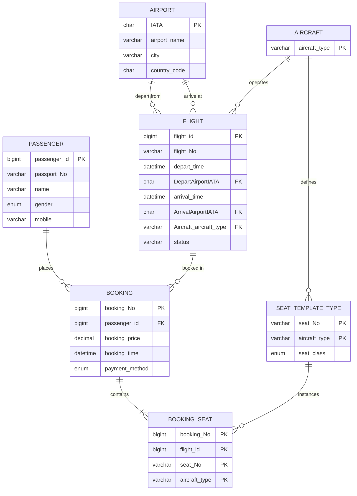

# SQL-practice
flight ticket booking
##此sql版本使用OneCompiler展示
# Flight Booking Database

A relational database design for an airline reservation system, covering flight
scheduling, passenger records, booking transactions and seat allocation.

Course project · MySQL 8.0

## Schema Overview



## Full ER Model

The original conceptual E-R diagram, including weak entity notation and
participation constraints that Mermaid cannot express:


## 实体说明

| 实体 | 类型 | 主键 | 说明 |
|---|---|---|---|
| Airport | 强实体 | IATA | 机场，三字码作为自然主键 |
| Aircraft | 强实体 | aircraft_type | 机型 |
| Flight | 强实体 | flight_id | 航班实例，使用代理键而非航班号 |
| Passenger | 强实体 | passenger_id | 乘客 |
| Booking | 事件型实体 | booking_No | 订单，随时间发生的事件 |
| Seat_template_type | 弱实体 | (seat_No, aircraft_type) | 每种机型的座位模板 |
| Booking_seat | 弱实体 | (booking_No, flight_id, seat_No, aircraft_type) | 售出的具体座位 |

## 设计要点

 **1. Flight 使用代理键 `flight_id`，而不是 `flight_No`** 

同一航班号每天执飞一次，因此 `flight_No` 在 `Flight` 表中不具备唯一性，不能作为主键。引入自增的 `flight_id` 后，`flight_No` 降级为普通属性，同时 `Booking` 通过 `flight_id` 关联到具体的航班实例（某一天某一班），而非抽象的航班号。

 **2. Flight 与 Airport 之间存在两个独立关系** 

出港（depart from）和进港（arrive at）是两条独立的 1:N 联系，分别由 `DepartAirportIATA` 和 `ArrivalAirportIATA` 两个外键实现，而不是一个包含三个实体集的 n 元关系。两端均为可选参与（optional participation），即允许存在没有航班起降的机场。

 **3. Booking 被建模为事件型实体（event entity）** 

订单记录的是一个发生在特定时间点的事件，因此 `booking_time` 是其固有属性的一部分，`payment_method`、`booking_price` 也仅在此情境下有完整语义。

 **4. 订单与座位分两层建模** 

`Booking` 承载交易信息，`Booking_seat` 承载座位分配信息。二者之间是识别关系（identifying relationship），`Booking_seat` 无法脱离 `Booking` 独立存在。这种分离符合第三范式，避免在一条记录中混合支付与选座两类语义。

## Key Queries

### 1. 查询某航班的剩余可售座位数

```sql
SELECT
    f.flight_id,
    f.flight_No,
    COUNT(st.seat_No) - COUNT(bs.seat_No) AS seats_available
FROM Flight f
JOIN Seat_template_type st
    ON st.aircraft_type = f.Aircraft_aircraft_type
LEFT JOIN Booking_seat bs
    ON bs.flight_id = f.flight_id
   AND bs.seat_No = st.seat_No
   AND bs.aircraft_type = st.aircraft_type
WHERE f.flight_id = ?
GROUP BY f.flight_id, f.flight_No;
```

以该机型的座位模板总数为基数，减去已被占用的座位数。使用 LEFT JOIN 而非 INNER JOIN，是为了让尚未售出任何座位的航班也能正确返回。

### 2. 查询某乘客的全部订单及航班信息

```sql
SELECT
    b.booking_No,
    b.booking_time,
    b.booking_price,
    b.payment_method,
    f.flight_No,
    f.depart_time,
    f.arrival_time,
    dep.city AS departure_city,
    arr.city AS arrival_city
FROM Booking b
JOIN Flight f       ON f.flight_id = b.Flight_flight_id
JOIN Airport dep    ON dep.IATA = f.DepartAirportIATA
JOIN Airport arr    ON arr.IATA = f.ArrivalAirportIATA
WHERE b.passenger_id = ?
ORDER BY b.booking_time DESC;
```

`Airport` 表被连接两次，分别取出发城市与到达城市，这是同一张表自连接的典型场景。

### 3. 按机场统计出港航班量并排名

```sql
SELECT
    a.IATA,
    a.city,
    COUNT(f.flight_id) AS departing_flights,
    RANK() OVER (ORDER BY COUNT(f.flight_id) DESC) AS ranking
FROM Airport a
LEFT JOIN Flight f
    ON f.DepartAirportIATA = a.IATA
GROUP BY a.IATA, a.city
ORDER BY ranking;
```

使用窗口函数 `RANK()` 在聚合结果上直接排名，避免嵌套子查询。使用 LEFT JOIN 保证没有任何出港航班的机场也计入统计（计数为 0）。

### 4. 查询某航班已售座位的舱位分布

```sql
SELECT
    st.seat_class,
    COUNT(bs.seat_No) AS seats_sold
FROM Booking_seat bs
JOIN Seat_template_type st
    ON st.aircraft_type = bs.aircraft_type
   AND st.seat_No = bs.seat_No
WHERE bs.flight_id = ?
GROUP BY st.seat_class;
```

## How to Run

1. 创建数据库：

```sql
CREATE DATABASE flight_booking CHARACTER SET utf8mb4;
```

2. 按以下顺序导入脚本（外键依赖决定顺序）：

```text
schema.sql        -- 建表与约束
sample_data.sql   -- 示例数据
queries.sql       -- 查询示例
```

3. 运行环境：MySQL 8.0 以上（`RANK()` 等窗口函数需要 8.0+）。

> 仓库中的示例数据均为虚构，不包含任何真实乘客信息。

## Known Limitations

- `Booking_seat` 中的 `flight_id` 与 `Booking` 表中的 `flight_id` 存在冗余，目前依赖应用层保证一致，未使用触发器约束。
- `Seat_template_type` 缺少座位总数上限约束（应不超过机型的 `seat_capacity`）。
- `Passenger.passport_No` 客观上应为候选键，但当前未添加 UNIQUE 约束。
- `status`、`gender`、`payment_method`、`seat_class` 的枚举取值域尚未在独立表中固化。
